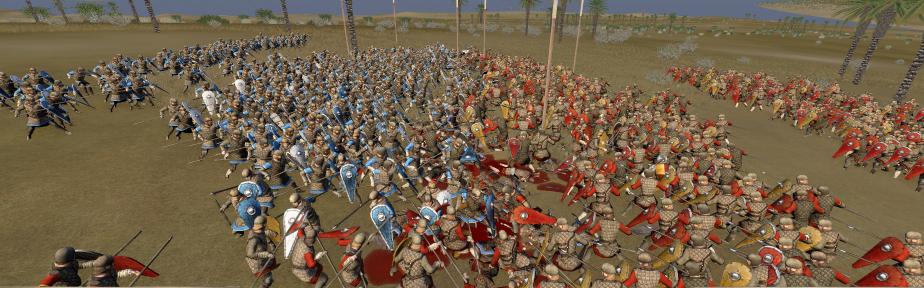
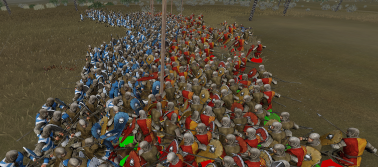

The coronavirus pandemic started at the end of 2019 and more or less officially ended sometime in 2023. Social distancing is no longer enforced, so why do my soldiers spread out all the way to Atlantis when they are in combat?

In the vanilla game, unit crowd spacing in combat is hardcoded, with no option for modders to change it. M2EX changes that!

You can now configure crowd spacing for individual units in `export_descr_unit.txt`.

## What is unit crowd spacing?

Before going into more detail, let's clarify what unit crowd spacing means.

As you may have noticed while playing Medieval 2, soldiers spread out during combat depending on their current state. We'll cover these states in more detail below. Soldiers check how many friendly soldiers are in front of them and, based on a calculation, gradually spread out in a particular direction.

Here is an example screenshot of unit crowd spacing with vanilla values:



They tend to spread out quite far towards the back. In my opinion, modders should be able to configure this.

Here is an example with modified values:



Some close-quarters combat that definitely breaks the social distancing rules! But how do we achieve this?

## Configuring crowd spacing

Add the following settings to a unit in `export_descr_unit.txt`:

```txt
; Base combat crowding multiplier.
; Lower values allow soldiers to stand closer together.
; Higher values make them avoid friendly soldiers more aggressively.
; Base spacing factor is 1.25
spacing_factor 0.1

; Combat-status spacing multipliers: non-combatant, winning badly, winning, winning slightly, even, losing slightly, losing, losing badly.
; Each value multiplies the base spacing.
status_spacing 0.25 0.5 0.5 0.75 1.0 1.25 1.5 1.75

; Fatigue spacing multipliers: fresh, warmed up, winded, tired, exhausted, most tired.
; Higher values make tired soldiers maintain more space.
fatigue_spacing 1.0 1.0 1.05 1.1 1.15 1.15

; Morale spacing multipliers: berserk, impetuous, high, firm, shaken, wavering, routing.
; Higher values make shaken, wavering, and routing soldiers spread out more.
morale_spacing 0.7 0.8 0.9 1.0 1.1 1.25 1.35
```

Without these settings, the unit uses the vanilla values. In this example, all values match the vanilla defaults except for `spacing_factor`, which has been changed to `0.1` to allow close-quarters combat.

As the comments explain, higher values make soldiers avoid friendly soldiers more aggressively, while lower values let them ignore the social distancing rules.

## How spacing is calculated

Alongside the base spacing factor, there are three other factors: status, fatigue, and morale. The comments for each setting describe how it works. Unit radius also plays a role in the calculation:

```
spacing_dist =
    soldier_diameter
    * spacing_factor
    * morale_factor
    * fatigue_factor
    * status_factor;
```

The calculation is fairly straightforward, but keep in mind that the closer soldiers stand together, the more their stats matter. For example, imagine a unit with high stats and two-handed weapons fighting regular spearmen. With tighter crowd spacing, the two-handed unit can defeat the spearmen more quickly because more of its soldiers can land hits at the same time.
